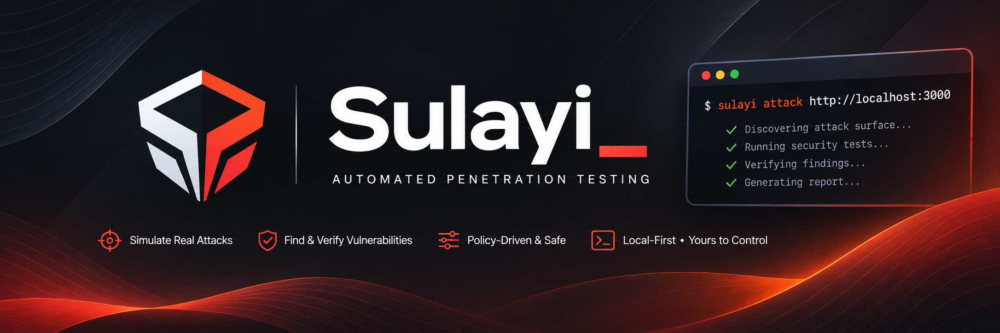

<p align="center">
  <a href="https://github.com/jaylordibe/sulayi/actions/workflows/ci.yml"></a>
  <a href="go.mod"></a>
  <a href="LICENSE"></a>
</p>

**Sulayi is a local-first penetration testing tool for applications you own.** Point it at
your running app, give it test accounts, and it attacks the app the way an outsider would
— then reports only what it could verify, and states plainly what it did not test.

```bash
sulayi attack http://localhost:3000
```

It runs on your machine as a single binary, needs no account or cloud service, and enforces
its own safety rules in code: scope, impact, request budgets and an audit log of every
request it sends.

> [!IMPORTANT]
> **Sulayi is early-stage (v0.x, unreleased).** Today it tests authentication and
> object-level authorization, signing in as your test accounts, on applications with or
> without an OpenAPI document. Injection and misconfiguration testing are planned, not
> built. See [Status](#status).

---

## Contents

- [Quick start](#quick-start)
- [How it works](#how-it-works)
- [Capabilities](#capabilities)
- [Usage](#usage)
- [Configuration](#configuration)
- [Safety](#safety)
- [Results and verification](#results-and-verification)
- [Status](#status)
- [Documentation](#documentation)

---

## Quick start

**Requirements:** Go 1.27.4 or newer, and a running application. An OpenAPI document
helps but is not required.

```bash
go install github.com/jaylordibe/sulayi/cmd/sulayi@latest
```

Start your application, then:

```bash
sulayi attack http://localhost:3000
```

Sulayi looks for an OpenAPI document at common paths such as `/openapi.json`,
`/api/docs-json` and `/v3/api-docs`, and crawls your app's own pages either way. Point it
at a specification if it lives elsewhere, or at a browser recording of a single-page app:

```bash
sulayi attack http://localhost:3000 --spec ./openapi.json
sulayi attack http://localhost:3000 --spec-url http://localhost:3000/docs/api.json
sulayi attack http://localhost:3000 --har ./app.har     # DevTools → Network → Save all as HAR
```

A real run against a small app whose admin endpoint forgot its authentication check:

```text
Sulayi assessment 20261118T170811Z-dbd055c8
  target:   http://127.0.0.1:62734
  profile:  standard
  surface:  5 operations from openapi-url
  oracle:   usable (declared)

  executed: 2
  blocked:  1
  untested: 2
  findings: 0 confirmed, 1 suspected
  requests: 16 of 1000

sulayi: policy threshold exceeded:
  - suspected high finding: Operation declared as requiring authentication is served
    without credentials (GET /api/admin/users)
```

The finding is *suspected*, not confirmed, because no test account was configured to
compare against. [Add identities](#identities) and the same defect can be confirmed.

> [!NOTE]
> The URL you pass **is the authorization you grant**. Sulayi contacts that origin and
> nothing else unless you widen scope in `sulayi.yaml`. Test only applications you own or
> are explicitly authorized in writing to test.

---

## How it works

```text
 target URL ──► discover ──► plan ──► attack ──► verify ──► report
                   │           │         │          │          │
            OpenAPI, adapters, │   every request    │    JSON, SARIF,
            HAR, bounded crawl │   through one      │    coverage ledger,
                               │   safety-enforcing │    request log
                               │   HTTP client      │
                 profile gate, scope,      authenticated control
                 request budget            requests, owner re-reads
```

1. **Discover.** The attack surface comes from whatever is available: an OpenAPI document,
   framework adapters (Laravel, NestJS) that read your source without executing it, a
   browser recording, and a bounded crawl of your app as each test account. None of them is
   required, and no source may guess an HTTP method.
2. **Plan.** Every operation is matched to the checks that apply to it. Anything that is
   not tested gets a ledger row saying why — no oracle, missing resource, safety policy,
   out of budget.
3. **Attack.** Requests go out through a single HTTP client that enforces scope, the
   safety profile, the request budget and credential binding on every request.
4. **Verify.** A response is not a finding. Sulayi repeats, compares and re-reads until a
   result is either proven or stays *suspected* with the reason it could not be proven.
5. **Report.** You get the findings, the evidence behind them, a ledger of what was and
   was not tested, and a log of every request sent.

---

## Capabilities

| Capability | Status |
|---|---|
| Missing authentication: endpoints declared protected but served anonymously | Implemented |
| Broken object-level authorization (BOLA/IDOR): reads and writes across two accounts | Implemented |
| Verification against an authenticated control request, with credential liveness checks | Implemented |
| Coverage ledger: tested, blocked and untested, with a machine-readable cause each | Implemented |
| Safety profiles, request budgets, interrupt handling and fixture restoration | Implemented |
| JSON and SARIF reports, redacted evidence, request audit log | Implemented |
| Framework adapters for Laravel and NestJS (static source reading) | Implemented |
| Undocumented surface hints from `Link`, `robots.txt` and the app's own JavaScript | Implemented (recorded, not tested) |
| Source analysis with your own opengrep/Semgrep rules | Experimental — Semgrep itself never executed |
| Nuclei and ZAP integrations | Built, **currently blocked** (see [Safety](#safety)) |
| Signing in through the app's own login: bearer token or cookie session (with CSRF), `--env` credentials files, roles, bounded re-authentication | Implemented — bearer logins are run against the Laravel Passport and NestJS JWT reference starters by the reference workflow; cookie sessions and CSRF are tested on local fixtures only |
| Testing across accounts and roles from records Sulayi creates and deletes itself, against declared ownership and role rules | Implemented — validated on local fixtures; the reference-starter run is pending |
| Testing applications without an OpenAPI document: framework adapters, browser recordings (HAR, discovery only) and a bounded same-origin crawler, with a declared access policy as the oracle | Implemented — the crawler reads server-rendered links only; a single-page app's API comes from a HAR |
| Injection and misconfiguration checks: boolean SQL injection, reflected XSS, template injection, open redirect, credentialed CORS, stack-trace disclosure — GET query and path parameters only | Implemented — validated on paired local fixtures |
| `sulayi report`, `sulayi verify <finding-id>` | Planned |

---

## Usage

```bash
sulayi attack <url>   # assess an application
sulayi init           # write a commented sulayi.yaml
sulayi doctor         # what is installed, configured and blocked; changes nothing
sulayi version        # version, Go toolchain and platform
```

`sulayi attack` flags:

| Flag | |
|---|---|
| `--profile` | `safe`, `standard` (default) or `aggressive` |
| `--spec <file>` | OpenAPI document on disk |
| `--spec-url <url>` | OpenAPI document served by the target |
| `--no-probe` | do not look for a specification at well-known paths |
| `-c, --config <file>` | configuration file (default `./sulayi.yaml` if present) |
| `-o, --output <dir>` | run output directory (default `.sulayi`) |
| `--env <file>` | credentials file of `NAME=value` lines; only names `sulayi.yaml` references are read |
| `--har <file>` | browser recording used only to find routes; nothing in it is replayed or stored |
| `--yes` | confirm `aggressive` where there is no terminal; changes nothing else |

### Exit codes

| Code | Meaning |
|---|---|
| `0` | ran; no policy threshold exceeded |
| `1` | findings exceeded the configured policy |
| `2` | invalid command line or configuration; nothing ran |
| `3` | executed no checks — establishes nothing |
| `4` | could not complete: target unreachable, interrupted, out of time or out of requests |
| `5` | internal error |

By default a run fails on any confirmed finding and on a suspected finding of high severity
or above. Suspected findings count on purpose: without test accounts nothing can be
confirmed, and a gate that passed a real authentication bypass would be worse than none.

---

## Configuration

Run `sulayi init` for a fully commented `sulayi.yaml`, or start from
[`sulayi.example.yaml`](sulayi.example.yaml). Everything is optional except the target.

### Identities

Test accounts let Sulayi compare what an anonymous caller gets with what a legitimate user
gets — the only way a finding reaches *confirmed*. Sulayi signs in through your app's own
login and uses the session it issues:

```yaml
identities:
  - id: alice
    role: member                       # reported only; grants nothing
    authentication:
      type: login
      login:
        path: /api/auth/login          # a path on the target, never a URL
        body:
          identifier: { env: ALICE_EMAIL }
          password: { env: ALICE_PASSWORD }
        session:
          bearer: /accessToken         # JSON pointer to the token; or: cookies: true
    liveness:                          # strongly recommended
      method: GET
      path: /api/users/me
```

Keep the credentials in a git-ignored file and pass it with `--env`:

```bash
# .env.sulayi.local  (git-ignored)
ALICE_EMAIL=alice@example.test
ALICE_PASSWORD=…

sulayi attack http://localhost:3000 --env .env.sulayi.local
```

- **A credential never goes in `sulayi.yaml`** — it only accepts references, so it is safe
  to commit. There is no `--token` flag: process listings and shell history outlive the run.
- **The credentials file lends only what is used.** Only names `sulayi.yaml` references
  are read; values never enter the process environment; a file git tracks is refused.
  Passing your app's own `.env` is safe in that sense, though a dedicated file is clearer.
- **The login is the one request every profile sends**, exactly as configured and nothing
  else.
- **Expired sessions are recovered.** When the `liveness` canary answers 401 or 419, the
  identity signs in again — at most three times a run, and the request that failed is
  never replayed. Results from the dead interval are withdrawn, not trusted.
- For a cookie session, `csrf: { cookie: XSRF-TOKEN, header: X-XSRF-TOKEN }` sends the
  CSRF cookie back in a header, and a `preflight` GET can fetch it first.
- A static token works too: `type: bearer` (or `apiKey` with a `header`) and
  `credential: { env: NAME }` or `{ file: path }`.

Use dedicated, minimally privileged test accounts.

### Without a specification

Sulayi crawls your app — GET only, on its own origin, to a fixed depth — as an anonymous
visitor and as each test account, and can read a browser recording (`--har`) or a
framework adapter's routing table. It never submits a form, never runs your JavaScript, and
never requests a sign-out route.

To make findings confirmable, say which routes should require authentication:

```yaml
access:
  protected: ["/api/**", "/dashboard"]     # * is one segment, a trailing ** any number
  public: ["/api/health", "/api/auth/**"]  # exceptions to the protected list
```

A declared policy states what should happen; a finding against it still has to be proven
by the usual verification. Without one, a route reachable only while signed in that serves
anonymous callers the same thing is reported as **suspected**, never confirmed.

### Owned resources

With two identities and a record one of them owns, Sulayi tests whether the other can
read or change it:

```yaml
resources:
  - id: order-alice
    type: order
    owner: alice
    crossOwnerAccess: denied           # required; "allowed" for shared records
    values:
      orderId: "abc123"                # fills /api/orders/{orderId}
    disposable: true                   # this exact record may be changed under `standard`
    mutation:                          # enables the write test
      values:
        status: "sulayi-marker"
```

A fixture applies only to operations that name the object, never to collections or health
endpoints. A write is confirmed only by the owner's own view changing, never by a `200`,
and the changed fields are restored afterwards.

### Records Sulayi creates, and roles

Instead of writing fixtures by hand, declare how to create a record. Sulayi creates one as
each identity, has the others try to read it, and deletes it afterwards, checking that it
is gone ([ADR-0022](docs/adr/0022-authorization-across-accounts-and-roles.md)):

```yaml
records:
  - type: device-token
    create:
      path: /api/device-tokens
      body:
        userId: { self: true }           # the creating identity's own id (liveness.self)
        token: { random: true }          # random per run
        appPlatform: { value: web }      # a literal
    id: /id                              # JSON pointer to the new record's id
    delete: /api/device-tokens/{id}

access:
  owned:                                 # records here belong to their creator
    - paths: ["/api/device-tokens/*"]
      reachableBy: [admin]               # roles that may reach anyone's, by design
  roles:                                 # reads only these roles may call
    - paths: ["/api/users", "/api/audit-logs/**"]
      allow: [admin]
```

An identity's own id comes from its canary: `liveness: { path: /api/users/me, self: /id }`.
A path no rule declares gets no conclusion. Under `standard`, the only state-changing
requests are each declared creation and the deletion of exactly what it created; `safe`
creates nothing. Every record is listed in the report, and one not removed is reported as
incomplete cleanup with its address. Routes are compared across roles with GET only.

### Injection and misconfiguration

Every GET operation's query and path parameters are tried with payloads from one closed
catalogue ([ADR-0023](docs/adr/0023-injection-and-misconfiguration-checks.md)). Each check
confirms only on an observation that cannot happen by chance: two independent SQL
true/false condition pairs steering the response, a unique tag returned unencoded in
HTML, `7*7919` rendered as `55433`, a `Location` naming a reserved `.invalid` host, an
arbitrary origin echoed with credentials allowed for a cookie session, or stack frames a
malformed value produced. `safe` sends only inert payloads; SQL conditions and template expressions need
`standard` and are sent only in reads, which the HTTP client enforces by recognising them
in the request. Request bodies are not tested yet, and the report says so.

---

## Safety

Every request passes through one HTTP client that makes the safety decision from the
request itself — never from a check's description of what it is about to send.

| Profile | Permits |
|---|---|
| `safe` | reconnaissance and read-only checks; nothing state-changing |
| `standard` (default) | also state-changing requests, but only the exact requests bound from fixtures declared `disposable`, changing only their configured fields, never `DELETE` |
| `aggressive` | state-changing and destructive tests against any in-scope target |

**`aggressive` needs three things:** `target.disposable: true` in `sulayi.yaml`, typing the
target's exact origin at the prompt (`--yes` replaces only the prompt where there is no
terminal), and scope entries that each name one exact origin.

| Control | |
|---|---|
| Scope | An allowlist checked on the URL before any DNS lookup and on every resolved address at dial time. Redirects are never followed. Cloud metadata addresses are always denied. |
| Credentials | Sent only to the identity's own target origin, never to another in-scope host. |
| Limits | `assessment.maxRequests` (default 1,000) and `assessment.maxDurationMinutes` (default 30). |
| Interrupts | Ctrl-C stops the run and kills child processes; once the assessment has started, it still writes its report. A second Ctrl-C exits at once. |
| Restoration | After a write, restoring the fixture runs on its own bounded budget, outside the time limit. A restoration that fails or cannot be verified is reported as **CLEANUP INCOMPLETE**. It is attempted, never guaranteed. |
| Audit | Every request — sent, refused or failed — is a redacted line in `requests.jsonl`. |
| Redaction | Secrets are redacted at capture, before anything reaches disk. A mitigation, not a guarantee. |

A read-only method is assumed not to change state unless you list it in
`assessment.stateChangingOperations` (for example `GET /logout`).

> [!WARNING]
> **Nuclei and ZAP are blocked in every profile.** They open their own network
> connections, which Sulayi's scope enforcement cannot constrain. Enabling them records a
> blocked ledger row and a **COVERAGE REDUCED** notice; neither is started. The
> integrations are kept for when a verified outbound control exists. See
> [ADR-0019](docs/adr/0019-safety-enforced-at-the-http-client.md).

---

## Results and verification

Each run writes one directory under `.sulayi/runs/`, created `0700` with files `0600`.
The `runs/` directory carries its own `.gitignore`, so evidence is never committed by
accident:

```text
.sulayi/runs/<run-id>/
  report.json       findings, evidence references and the coverage ledger
  report.sarif      SARIF 2.1.0 for code-scanning tools
  requests.jsonl    one redacted line per request
  evidence/         the exchanges behind each finding, content-addressed
  meta.json         what produced the run
  fingerprint.key   per-run key for correlating redacted values
```

**How a finding earns its state:**

- **Suspected** until verification succeeds. A single anonymous `200` is not proof:
  Sulayi fingerprints catch-all routes, error envelopes inside `2xx` bodies and cache hits,
  and repeats the request.
- **Confirmed** only when a live authenticated control matches materially — same outcome,
  status, content type and JSON shape, and no cache hit.
- **Cross-owner reads** need three requests: the owner reads, the other account probes, the
  owner reads again, so a record that vanished mid-test cannot pass as a denial. A read is
  confirmed only when the other account got *that* record.
- **A broken credential never produces a clean result.** An expired or rejected token
  becomes a blocked row and a named gap, never a pass.
- **External engine results are observations**, recorded verbatim and never promoted.

The ledger is the other half of the report. A run that tested a tenth of the surface and
found nothing is not a clean result, and Sulayi says so — with a cause for every operation
it did not test.

---

## Status

Sulayi is pre-1.0 and has no published release. Output schemas may change.

- **Evidence so far:** paired vulnerable and secure fixtures in the evaluation harness, two
  reference applications assessed in a weekly CI workflow, and manually triggered
  real-binary integration tests for the engines. Precision and recall on real applications have **not** been
  measured, so no detection-quality claim is made.
- **Platforms:** CI builds and tests on Linux, macOS and Windows.
- **Next:** authorization testing across roles and accounts, then injection and
  misconfiguration checks, each with runtime verification. Optional AI assistance comes
  later and will never be required.

Known limits today: BOLA testing needs you to name one record per owner; there is no
tenancy or function-level authorization testing yet; OAuth authorization flows, OIDC, MFA
and browser login are not supported; and an application whose `GET` endpoints change
state is protected only as far as you list them.

---

## Documentation

| | |
|---|---|
| [Architecture](docs/architecture.md) | pipeline, packages and boundaries |
| [Threat model](docs/security/threat-model.md) | Sulayi's own attack surface, each control tied to a test |
| [Architecture decisions](docs/adr/) | every consequential decision and the alternatives rejected |
| [External engines](docs/engines/README.md) | Nuclei, ZAP and source analysis: configuration and status |
| [Writing an adapter](docs/adapters/contract.md) | the adapter contract, in any language |
| [Roadmap](docs/roadmap.md) | the phases to the MVP, what is done and what is next |
| [Changelog](CHANGELOG.md) | what changed |

## Contributing

Contributions are welcome. Read [CONTRIBUTING.md](CONTRIBUTING.md) first. `make check` runs
what CI runs, and `go test ./...` needs no network, database or external engine.

## Security

Report vulnerabilities in Sulayi itself privately through
[GitHub security advisories](https://github.com/jaylordibe/sulayi/security/advisories/new),
as described in [SECURITY.md](SECURITY.md).

## License

Apache-2.0. See [LICENSE](LICENSE) and [NOTICE](NOTICE). Sulayi is not affiliated with
OWASP, Checkmarx, ProjectDiscovery, Semgrep Inc. or Praetorian; their names are used only
to identify their projects.
